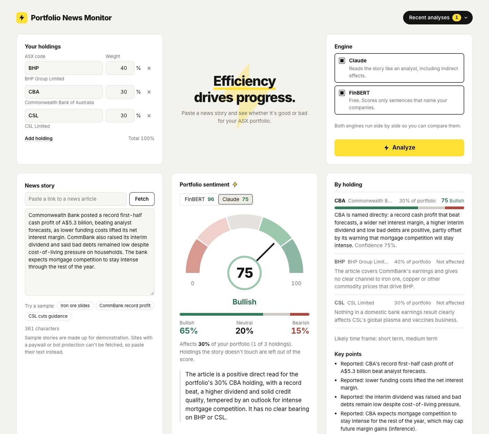

# Portfolio News Monitor

Paste a news story, and see whether it's good or bad for **your** ASX portfolio, weighted by what you hold.

Most sentiment tools tell you whether an article sounds positive. This one asks a narrower question: *given the
companies I own and how much of each, does this story help or hurt me?* It scores every holding, drops the ones the
story doesn't touch, and rolls the rest into one 0–100 reading on a gauge.



## Two engines, side by side

| | **Claude** | **FinBERT** |
|---|---|---|
| What it is | Anthropic's LLM, called through the API | [`ProsusAI/finbert`](https://huggingface.co/ProsusAI/finbert), a BERT model fine-tuned on financial text |
| Cost | Pay per request, needs an API key | Free, runs on your machine |
| How it decides relevance | Reasons about direct *and* indirect effects: commodity prices, rates, the dollar, suppliers, competitors | Only sentences that name the company (ticker, legal name, or a common alias like "CommBank") |
| Extras | One-line reason per holding, summary, key points, risks, what to watch, time frame | The sentences it scored, quoted |

You can run both at once and compare. The sample story **"Iron ore slides"** shows the difference well: it never
names a company, so FinBERT finds nothing relevant, while Claude links falling iron ore prices to miners like BHP.

## Fetch a story from a link

Paste a link to a news article and press **Fetch**. The backend downloads the page, pulls out the headline and article
text with [trafilatura](https://trafilatura.readthedocs.io/), and drops it into the story box so you can check it
before you analyze. Sites with a paywall or bot protection (Reuters, the AFR) can't be fetched; the app says so, and you
can paste the text instead. The server only fetches public addresses on the standard ports, and re-checks every
redirect.

## How the score works

1. Each engine rates each holding as bullish, neutral, or bearish, as probabilities that add up to 100%.
2. Holdings the story doesn't affect are left out, and the remaining weights are rescaled to add up to 100%.
3. The portfolio probabilities are the weighted average of the holdings' probabilities.
4. **Score = 50 + 50 × (bullish − bearish)**, so 0 is certainly bearish, 50 is balanced, and 100 is certainly bullish.
   It's rounded to a whole number with halves rounding up, so 60.5 is 61 (Bullish).

| Score | Reading |
|---|---|
| 0–19 | Strongly bearish |
| 20–39 | Bearish |
| 40–60 | Neutral |
| 61–80 | Bullish |
| 81–100 | Strongly bullish |

Alongside the score, the app shows **exposure**: the share of your portfolio the story actually touches. A strongly
bearish story about a 5% holding is a very different thing from one about 60% of your money.

The app shows this working for every result under "How this score was worked out".

## Run it locally

You need Python 3.11–3.13 and Node 20.19 or later. FinBERT depends on PyTorch, which doesn't support Python 3.14+ yet,
so the steps below use [uv](https://docs.astral.sh/uv/) to create a Python 3.13 environment.

**Backend** (port 8000):

```bash
cd backend
uv venv --python 3.13
uv pip install -e ".[finbert,dev]"
cp .env.example .env          # add ANTHROPIC_API_KEY here to turn on Claude
.venv/bin/uvicorn app.main:app --reload --port 8000
```

The first start downloads the FinBERT model (about 440 MB) in the background.

**Frontend** (port 5173), in a second terminal:

```bash
cd frontend
npm install
npm run dev
```

Open http://localhost:5173. The dev server forwards `/api` to the backend.

### Turning on Claude

Create an API key at [console.anthropic.com](https://console.anthropic.com), put it in `backend/.env` as
`ANTHROPIC_API_KEY=...`, and restart the backend. Without a key the app works with FinBERT only. The default model is
`claude-opus-5-5`; set `CLAUDE_MODEL` to use a different one.

### Hosting the frontend and backend on different sites

The frontend is a static site (`npm run build` writes `frontend/dist/`), so it can go on a static host while the backend
runs somewhere that can run Python. Two settings connect them:

| Setting | Where | Example |
|---|---|---|
| `VITE_API_URL` | frontend, when you run `npm run build` | `https://portfolio-news-api.onrender.com` |
| `ALLOWED_ORIGINS` | backend environment | `https://portfolio-news.pages.dev` |

`ALLOWED_ORIGINS` lists the exact sites (comma-separated) that browsers may call the API from. The backend refuses to
start if a value isn't a full address like `https://example.com`, and it never accepts `*`. Leave both unset for local
development. CORS only stops other websites from calling the API inside a visitor's browser; it doesn't stop scripts.

### Rate limits

Each visitor may run 10 analyses and 10 article fetches a minute (60 an hour each) and 120 ticker searches a minute;
more get a `429` with a `Retry-After` header. At most two analyses run at once, and a third waits up to 20 seconds
before the server answers that it's busy. The counts are kept in memory, so they hold for a single server process.

Behind a hosting proxy every request arrives from the proxy's address, so set `TRUSTED_PROXY_HOPS` to the number of
proxies in front of the backend (usually `1`); the backend then reads the visitor's address from `X-Forwarded-For`,
counting from the right so a visitor can't fake it. Don't set uvicorn's `FORWARDED_ALLOW_IPS` to `*`: uvicorn then
believes the left-most address, which the visitor writes.

## Tests

```bash
cd backend && .venv/bin/pytest     # scoring, ASX matching, both engines (mocked), article fetching (mocked), API
cd frontend && npm test            # gauge zones, holdings checks, history, skipped-holding notices, engine availability
```

Backend tests don't download the model or call the API.

## Project layout

```
backend/
  app/aggregate.py          the scoring math above, as pure functions
  app/asx.py                ASX company list, search, and "does this sentence name this company?"
  app/engines/finbert_engine.py
  app/engines/claude_engine.py
  app/article.py            Fetch a news page and extract its headline and text
  app/main.py               FastAPI routes: /api/health, /api/tickers, /api/article, /api/analyze
  data/asx_companies.csv    all ~2,050 ASX-listed companies
  scripts/build_asx_list.py regenerates the CSV from asx.com.au
frontend/
  src/components/SentimentGauge.tsx   hand-built SVG gauge
  src/lib/gauge.ts                    gauge geometry
  src/App.tsx
```

## Design notes

- **The backend checks every number from the LLM.** Claude answers in a fixed JSON schema
  (structured outputs). Its probabilities are then clamped, rescaled to add up to 100%, and matched against the
  tickers you actually sent. Unknown tickers are dropped. A holding Claude leaves out is marked "Not assessed",
  kept out of the score, and named in a notice, rather than shown as unaffected.
- **Tickers that double as words or news acronyms** (`CAR`, `WOW`, `ORG`, `AFL`, `NRL`, `SPP`, and others) only match
  with an exchange marker (`ASX: CAR`, `CAR.AX`) or the company's name. Otherwise "every car sold" would count as news
  about CAR Group.
- **Aliases are case-sensitive**, so "Origin said…" counts for Origin Energy but "the origin of the rally" doesn't.
  Places and events that share a company's name, such as "State of Origin" or "Port Macquarie", are ignored.
- **FinBERT scores each company on its own clause.** "BHP surged, while CBA plunged" is split at "while", so BHP
  reads bullish and CBA bearish instead of both getting the same score.
- Holdings and your last 20 analyses are saved in your browser only.

The prompt rules (separate facts from inference, don't guess tickers, don't overstate one-off news, no price targets)
were adapted from [tw_stock_news_ai_monitor](https://github.com/jordan5226/tw_stock_news_ai_monitor). The gauge was
inspired by Stocktwits' sentiment meter.

## Limitations

- FinBERT reads tone sentence by sentence. It can't follow indirect effects or sarcasm. When a sentence names two
  holdings with no word like "while" or "but" to split on ("BHP rose and CBA fell"), both get the same score, and the
  reason says so. Very long sentences are cut to the words around the company's name to fit its 512-token limit.
- Name matching can't tell people from companies, so "analyst Sarah Goodman" counts as a mention of Goodman Group.
- Claude's probabilities are its own judgement, not calibrated forecasts.
- The sample stories in the app are made up.

**For research and education only. Not investment advice.**

## License

MIT. See [LICENSE](LICENSE).
